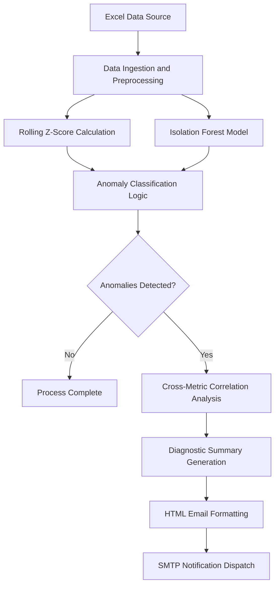

# Business Metric Anomaly Detection Agent

A Python-based anomaly detection system designed to monitor time-series business metrics, identify statistical and multivariate outliers, generate diagnostic summaries, and dispatch automated notification reports.

## Table of Contents

- [Overview](#overview)
- [System Architecture](#system-architecture)
- [Key Features](#key-features)
- [Project Structure](#project-structure)
- [Prerequisites](#prerequisites)
- [Installation and Setup](#installation-and-setup)
- [Configuration](#configuration)
- [Usage](#usage)
  - [Generating Test Data](#generating-test-data)
  - [Running the Detection Agent](#running-the-detection-agent)
- [Detection Methodology](#detection-methodology)
- [Troubleshooting](#troubleshooting)
- [License](#license)

## Overview

The Business Metric Anomaly Detection Agent analyzes numerical business metrics stored in Excel spreadsheets (such as Revenue, Website Visits, Signups, and Refunds). It employs a dual-engine architecture combining rolling statistical evaluation (Z-Score) with unsupervised machine learning (Isolation Forest) to detect anomalies while minimizing false positives. When anomalies are identified, the system performs cross-metric correlation analysis, prepares an executive diagnostic summary using configured language models (or heuristic fallback), and delivers a formatted HTML report via SMTP.

## System Architecture



## Key Features

- **Hybrid Anomaly Detection**: Combines a 7-day rolling Z-score model for temporal trend shifts with Scikit-Learn's Isolation Forest algorithm for multivariate outlier detection.
- **Configurable Detection Modes**: Supports `HYBRID`, `Z_SCORE`, and `ISOLATION_FOREST` modes to adapt to different data characteristics.
- **Root-Cause Correlation**: Evaluates relationships between primary metrics (e.g., Revenue) and secondary indicators (e.g., Website Visits, Signups, Refunds) during anomaly windows.
- **Diagnostic Reporting**: Produces executive-level diagnostic summaries via Google Gemini, Anthropic Claude, or a built-in rule-based heuristic engine when API keys are not supplied.
- **Automated HTML Notifications**: Dispatches responsive HTML alert emails featuring key metrics, severity indicators, diagnostic findings, and tabulated anomaly records.
- **Zero-Configuration Defaults**: Includes default dataset generators and sample workbooks for immediate evaluation.

## Project Structure

```text
.
├── agent.py                      # Main detection pipeline, analysis, and alerting logic
├── config.py                     # Central configuration and environment settings
├── file.py                       # Synthetic business metric data generator
├── business_metrics_sample.xlsx  # Sample business metrics dataset
├── data/
│   └── business_metrics.xlsx     # Default output directory for generated data
├── .env.example                  # Environment variable configuration template
├── .gitignore                    # Git file exclusion rules
├── requirements.txt              # Project package dependencies
└── README.md                     # Project documentation
```

## Prerequisites

- **Python**: Version 3.10 or higher
- **Email Service**: Gmail account with an App Password enabled (required for email dispatch)
- **API Access** (Optional): Google Gemini API key or Anthropic Claude API key for LLM-powered summaries

## Installation and Setup

### 1. Clone the Repository

```bash
git clone https://github.com/arnavvv454/anomaly.git
cd anomaly
```

### 2. Create and Activate a Virtual Environment

On Windows (PowerShell):
```powershell
python -m venv .venv
.venv\Scripts\Activate.ps1
```

On macOS / Linux:
```bash
python3 -m venv .venv
source .venv/bin/activate
```

### 3. Install Dependencies

```bash
pip install -r requirements.txt
```

### 4. Configure Environment Variables

Create a `.env` file based on the provided template:

```bash
cp .env.example .env
```

Edit `.env` with your credentials:

```ini
AI_PROVIDER=gemini
GEMINI_API_KEY=your_gemini_api_key_here
ANTHROPIC_API_KEY=your_anthropic_api_key_here

SENDER_EMAIL=your_email@gmail.com
SENDER_APP_PASSWORD=your_16_digit_app_password
RECEIVER_EMAIL=recipient_email@gmail.com
```

If email or LLM credentials are omitted, the agent will output diagnostic findings to the console and skip notification dispatch.

## Configuration

All core parameters can be customized in `config.py` or overridden via environment variables:

| Parameter | Default | Description |
| :--- | :--- | :--- |
| `INPUT_FILE` | `business_metrics_sample.xlsx` | Path to the input Excel spreadsheet. |
| `SHEET_NAME` | `0` | Sheet index or sheet name to read. |
| `DATE_COLUMN` | `"Date"` | Name of the timestamp column. |
| `VALUE_COLUMN` | `"Revenue"` | Primary metric evaluated for anomalies. |
| `ROLLING_WINDOW` | `7` | Number of periods used for rolling mean and standard deviation. |
| `Z_SCORE_THRESHOLD` | `2` | Absolute Z-score threshold to flag a point as anomalous. |
| `ANOMALY_METHOD` | `"HYBRID"` | Detection method: `HYBRID`, `Z_SCORE`, or `ISOLATION_FOREST`. |
| `CONTAMINATION` | `0.05` | Expected outlier proportion for Isolation Forest. |
| `AI_PROVIDER` | `"gemini"` | Language model provider: `"gemini"` or `"anthropic"`. |
| `GEMINI_MODEL` | `"gemini-2.5-flash"` | Target Gemini model identifier. |
| `CLAUDE_MODEL` | `"claude-sonnet-4-5"` | Target Claude model identifier. |
| `HTML_EMAIL` | `True` | Flag to generate and send multipart HTML email alerts. |

## Usage

### Generating Test Data

To generate a synthetic dataset spanning 100 days with an injected anomaly at day 50:

```bash
python file.py
```

This writes `data/business_metrics.xlsx`.

### Running the Detection Agent

To execute the detection pipeline:

```bash
python agent.py
```

Execution steps performed:
1. Validates file existence and loads time-series data.
2. Applies rolling window statistical analysis and Isolation Forest model evaluation.
3. Classifies points exceeding threshold bounds and tags severity (`CRITICAL` or `WARNING`).
4. Generates an executive diagnostic report.
5. Dispatches formatted HTML and plaintext email notifications to configured recipients.

## Detection Methodology

1. **Statistical Rolling Z-Score**:
   Calculates moving average ($\mu$) and moving standard deviation ($\sigma$) across a window of $N$ periods:
   $$Z = \frac{X_t - \mu_t}{\sigma_t}$$
   Observations where $|Z| \ge \text{threshold}$ are flagged.

2. **Isolation Forest Machine Learning**:
   Constructs an ensemble of isolation trees on available numerical features to isolate anomalies based on path lengths. Points with shorter average path lengths receive higher anomaly scores.

3. **Hybrid Decision Logic**:
   When set to `HYBRID`, anomalies identified by both models receive priority classification (`CRITICAL`). Single-model triggers are vetted with threshold offsets to prevent false positives.

## Troubleshooting

- **SMTP Authentication Error**: Verify that 2-Factor Authentication is active on the sender account and that an application-specific password (16 characters) is used rather than the primary account password.
- **Missing Environment Variables**: Ensure `.env` is located in the project root directory alongside `config.py`.
- **Custom Column Names**: Update `VALUE_COLUMN` and `DATE_COLUMN` in `config.py` to match the column headers in your spreadsheet. Any remaining numeric columns are automatically utilized for multivariate context.

## License

This project is licensed under the MIT License.
